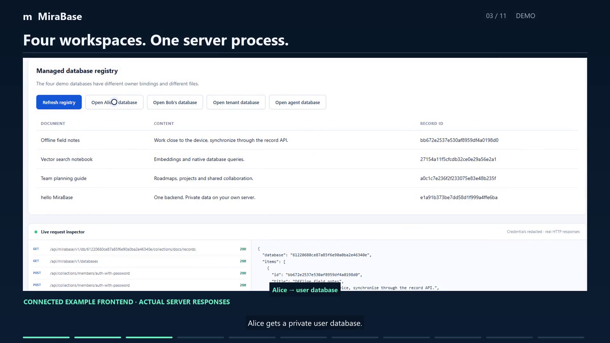

# MiraBase

**One backend. A private database for every user, tenant, and agent.**

MiraBase extends the PocketBase backend and dashboard with the Turso database engine. Build your frontend against collections, authentication, rules, files and realtime; optionally give each customer, workspace, user or agent its own database in one server process.

The backend includes collection APIs, account flows, files, realtime, email, trusted Go/JavaScript extensions and administration. MiraBase adds database-per-user/tenant/agent layouts, grants, four search modes, schema plans and rollouts, references/reports, durable changes, record-sync APIs, live queries, workspace snapshots, PostgreSQL client access and PocketBase adoption workflows.

[Quick start](docs/user/quickstart.md) · [Complete feature catalog](docs/features.md) · [Task guides](docs/user/index.md) · [API reference](docs/user/api-reference.md) · [Agent guide](docs/agents/README.md) · [Source/evidence](docs/current-product.md) · [Launch status](docs/launch/status.md)

[Watch the three-minute application demo](demo/media/MiraBase-Submission-3min.mp4) · [Read the submission](demo/submission/SUBMISSION.md)

[](demo/media/MiraBase-Submission-3min.mp4)

**Current status:** integrated code extends beyond the original v0.1 allocation, but this candidate remains unqualified for release. Managed CRUD policy parity, complete offline/native sync, full AgentFS, independent application runtime isolation and additional platform/security/recovery acceptance remain open. Feature descriptions below identify important limits; [launch status](docs/launch/status.md) owns executed results. A route, source file or successful build does not establish full acceptance.

## What users get

Configure the backend in the existing dashboard, connect your frontend, and extend application-specific behavior through Go or JavaScript when needed. A small application can start with shared storage. A larger application can give individuals, teams and agents separate database files while retaining shared backend services.

| Storage choice | Who shares the data? | Example |
|---|---|---|
| Shared | Application-defined accounts under collection rules | Product catalog or common application records. |
| User | One account's private database context | Alice's personal notes. |
| Tenant | Members of a company/team/workspace | Northstar's projects shared by its employees. |
| Agent | An explicitly bound agent identity | A research agent's records. |

A user can belong to multiple tenants. A tenant database is a storage boundary inside an application; full independent application auth/settings/hooks isolation is a separate unfinished integration. Separate files do not replace authorization.

## Explore the product

- [Run the backend](#start-your-backend).
- [Backend features](#backend-features): dashboard, data, identity, files, realtime and email.
- [MiraBase extensions](#mirabase-extensions): private storage, search, schemas, sync, agents and SQL clients.
- [Developer tools and operations](#developer-tools-and-operations).
- [Delivery and scaling](#one-process-many-databases).
- [Managed cloud design](#managed-cloud).
- [Build from source](#build-from-this-folder).

## Start your backend

Use a signed, qualified artifact matching your platform when a release is published. No download domain or live hosted service is implied by this source tree.

```sh
mirabase serve --http=127.0.0.1:8090
```

Open the setup URL printed at startup, create the first superuser, then open `http://127.0.0.1:8090/_/`. Configure collections, access rules, files and email, then connect your frontend. Shared storage is the default. Private storage requires neither an organization account with us nor a process per database.

## Backend features

### Dashboard and collections

- Existing administration UI, first-superuser setup, collection/record editors and auth administration.
- Base collections for data, auth collections for identities and read-only SQL view collections.
- Schema/index configuration, rule editors, relation selectors, schema import/export, relationship diagrams and generated API previews.
- Record filtering, sorting, pagination, projection, relation expansion, multipart files, field modifiers and configured atomic batches on the inherited API.
- Field-level validation errors and configurable required/hidden/system/unique behavior.

Inherited fields include text, number, boolean, email, URL, rich text, password, date, autodate, select, JSON, relation, file and geopoint. Additional managed adapters exist for int64, decimal, UUID, typed date/time/timestamp, network addresses and vectors; complete dashboard/core-field/SDK parity for every added adapter remains open.

[Foundation guide](docs/user/foundation.md) · [Field guide](docs/user/fields.md)

### Authentication and access rules

- Multiple authentication collections and configurable identity fields.
- Password, OAuth2/OpenID Connect, OTP and optional MFA.
- Refresh, verification, password reset, email changes, authentication alerts and token-lifetime configuration.
- Authorized impersonation, external-auth associations and authentication-management rules.
- Separate list/view/create/update/delete rules with locked, public or expression-based access.
- Request/auth/relation-aware filters and protected secret fields on inherited record paths.

Provider adapters include the major identity providers and generic OIDC; the [complete catalog](docs/features.md#8-authentication-and-accounts--inherited) lists the configured adapter families. Providers require their own credentials.

**Managed-record limitation:** the additional `/api/mirabase/v1/db/...` CRUD handlers currently check ownership/grants and invoke a raw store. Complete inherited record rules, forms, hooks and hidden-field behavior are not applied there. The normal inherited record API is separate. Do not treat private database grants as full collection-policy parity.

[Authentication](docs/user/authentication.md) · [Rules](docs/user/rules-and-filters.md) · [Implementation limits](docs/current-product.md)

### Files, email and realtime

- Local/S3-compatible file storage, single/multiple uploads, field limits, generated names, protected tokens, streaming downloads, thumbnails and cleanup.
- SMTP/sendmail, configurable templates, account-flow mail, test emails and extension helpers.
- SSE subscriptions to collections/records with create/update/delete notifications.
- Static frontend hosting and configurable server/network settings.

Realtime notifications, durable changes and live-query results are separate capabilities. DB-only backups do not automatically contain remote S3 objects.

[Files](docs/user/files.md) · [Realtime](docs/user/realtime.md) · [Account flows](docs/user/authentication.md)

## MiraBase extensions

### Private databases and provisioning

- Shared, user, tenant and agent layouts; primary and manual database kinds.
- Server-generated IDs, owner/template bindings, manifests, generation/schema tracking and lifecycle states.
- Storage setup plan/preview/apply; lazy or configured eager provisioning.
- Concurrent provisioning convergence and template application before readiness.
- Tenant membership and invitation create/accept/revoke.
- Explicit database/tenant context, owner transfer, scoped grants, expiry and revocation.
- Database create/list/inspect/delete, maintenance, profile and diagnostics operations.

Joining an existing tenant reuses its database. Several eligible memberships require a choice. Changing an existing populated layout requires reviewed transformation; it is not a silent toggle.

[Database layouts and workflow](docs/user/databases.md) · [Membership/schema operations](docs/user/schema-and-workflows.md)

### Four search modes

| Mode | Capabilities |
|---|---|
| Vector | Caller-supplied vectors; dimension/finite checks; compatible cosine, L2, negative-dot and representation-dependent Jaccard metrics. |
| Full text | Selected fields, simple/advanced syntax, weights, highlights and default/stem/raw/simple/whitespace/ngram tokenizers. |
| Hybrid | Text/vector rank combination through reciprocal-rank fusion. |
| Fuzzy | Levenshtein, Damerau, optimal string alignment, Hamming, Jaro–Winkler and Soundex with compatible thresholds. |

Search includes limits, candidate budgets, deadlines, deterministic ties, completion/scanned metadata and context-bound continuation leases. Embedding generation is not bundled. Exact vector search is not a claim of complete ANN coverage.

[Search examples and limits](docs/user/search.md)

### Schemas, shared references and reporting

- Plan schema changes, inspect destructive effects/blockers and apply a reviewed plan hash against an expected revision.
- Create/update/delete managed collections and create/drop supported ordinary/FTS indexes.
- Publish templates and run/pause/resume/retry database rollouts with target-level outcomes.
- Define filtered nonsecret reference copies; refresh/read copies and inspect lag/failure/quarantine state.
- Define versioned relation delete/unlink workflows and inspect partial outcomes.
- Define/rebuild/read reports across matching databases.

Unsupported custom-type/view/sequence operations in the additive planner are refused. Inherited view collections remain separate. References and workflows do not provide cross-file ACID transactions.

[Schema and derived-data guide](docs/user/schema-and-workflows.md)

### Durable changes, record sync and live queries

- Ordered committed record-change history with pull/stream endpoints and retained replay boundaries.
- Record bootstrap/pages, grouped mutation push, incremental pull, acknowledgements and file staging/upload.
- Named revisioned SQL live plans, typed parameters, dependencies, unique result keys, publish/retire controls and authorized registration.
- Initial live-result snapshots, keyed changes, bounded replay, resets and cancellation.

Whole-system CDC capture needs evidence for each writer. Bootstrap/page currently requires operator authority; complete ordinary-user offline stores and upstream native whole-DB sync interoperability remain open. Live-query shapes that cannot be safely narrowed for ordinary actors may be refused.

[Changes/live queries](docs/user/changes-and-live.md) · [Sync workflow](docs/user/synchronization.md)

### Agent workspaces

- Owner-bound workspace create/list and file write/read/delete.
- File metadata, versions and content hashes.
- Snapshots retaining historical bytes; hash/path checks before restoring overwritten/deleted files.
- Preservation of files outside the snapshot and explicitly instrumented tool-history helpers.

Current HTTP operations are superuser-only, use string content, and cap snapshot content at 64 MiB. Multi-file crash-atomic restore and full upstream AgentFS KV/inode/chunk/overlay/mount/replication integration remain open. Do not give an untrusted agent a superuser token.

[Workspace API and boundaries](docs/user/agent-workspaces.md)

### PostgreSQL client access

The optional gateway provides TLS/SCRAM, separately scoped SQL credentials, simple and extended queries, prepared statements/parameters, statement/portal/session lifecycle, transaction state, cancellation and timeouts. Actual external-client evidence includes node-postgres with verified TLS and prepared queries.

It is not a complete PostgreSQL server. COPY, binary formats, introspection, SQL dialect and ORM compatibility need specific qualification. Record rules do not constrain privileged SQL as if it were ordinary record access.

[Enable and use the PostgreSQL gateway](docs/user/postgresql.md)

### PocketBase adoption

- Upload/check sources; analyze collections, identities, settings, records, files and artifacts.
- Review plans, previews, destination/tenant allocation and issues.
- Stage, validate, inspect report cases and explicitly cut over.
- Resume/recover/cancel sessions and create/inspect/run/cancel multi-source batches.
- Preserve source provenance and distinguish shared adoption from per-user/tenant/agent conversion.

The pinned baseline is PocketBase v0.41.1. Complete no-loss conversion, arbitrary historical-version support and independent-app consolidation require further acceptance. Collection schema import alone is not full application adoption.

[Import procedure and recovery](docs/user/pocketbase-import.md)

## Developer tools and operations

### Extensions, scheduling and migrations

Go embedding, hooks, custom models/proxies/routes/middleware/commands, transaction/file/mail/log/template helpers and test utilities remain available. Goja adds trusted JavaScript hooks/migrations and route/cron bindings. Cron and migration history/up/down/generation are application-wide tools; managed schema rollout is a distinct workflow.

Trusted extensions have process privileges. Goja is not Node.js, and installed hooks are not hostile tenant-code sandboxes.

[Extensions](docs/user/extensions.md) · [Jobs/migrations](docs/user/jobs-and-migrations.md)

### SDKs and APIs

JS/TS and Dart packages provide application clients, immutable database/tenant views, generic authenticated requests and managed-record helpers. Other languages can use HTTP/streams or individually qualified compatible drivers. The normal inherited API remains under `/api/collections`, `/api/files` and `/api/realtime`; MiraBase additions use `/api/mirabase/v1`.

The owned wrappers are not complete inherited auth/files/realtime clients or offline local engines. Dart currently uses `dart:io`; Flutter Web is not established. Registry publication is not implied by local packages.

[SDK methods and examples](docs/user/sdks.md) · [Actual route reference](docs/user/api-reference.md)

### Jobs, recovery and diagnostics

- Durable jobs with enqueue/lease/renew/reconciliation, status/results, cancellation and recorded steps.
- Idempotency receipts, unknown-outcome reconciliation and transactional outbox helpers.
- Application/managed-target backups, checksums/manifests, configured file coverage, dry-run/restore-to-new behavior and portable interchange.
- Maintenance, integrity checks, checkpoints, supported vacuum/FTS/GC actions and generation-aware operations.
- Logs, statistics, disk/WAL/FTS size, open connections, leases and failed-job inspection.

Recovery remains subject to open acceptance gates. The latest Windows concurrent-backup regression passes; it does not establish full platform/fault coverage. Native page encryption/key rotation/custom codecs are currently refused, despite related route/config names. Outbox/settings protection is a separate layer.

[Operational procedure](docs/user/operations.md) · [Errors and recovery decisions](docs/user/errors-and-troubleshooting.md)

### Application registry

Create/list/get/state/delete/bootstrap APIs and per-app supervisor/directory machinery are present. Complete independently isolated application execution is not established. Application update/backup/restore and one per-application import-source listing operation remain unregistered; the batch-level sources endpoint is separate.

The [42-family feature catalog](docs/features.md) retains the detailed inventory and each important boundary. [Current product](docs/current-product.md) connects families to source/tests; [launch status](docs/launch/status.md) records actual acceptance.

## One process, many databases

One HTTP server and bounded shared services manage many files. Databases do not each get a process, scheduler or warm JS VM. Turso runs in-process through Go bindings. The current executable embeds a native payload, verifies its compiled-in digest and extracts it to a private cache before loading.

Standalone growth uses a larger machine and a verified move of the complete application state. There is no vendor database-count quota; CPU, RAM, disk, connections and admission limits remain real. Cold database count differs from active concurrency. One hot database does not automatically distribute its writes across machines.

Fresh paths are `mb_data`, `mb_hooks`, `mb_migrations` and `mb_public`. Databases, sidecars, files, keys and recovery state live outside the executable. Copying one `data.db` is not a full application backup.

## Managed cloud

The planned managed platform retains the frontend/API and database model while our infrastructure handles placement, replication, routing, failover, balancing, cold databases, backups, quotas and metering.

[Cloud product](docs/cloud/README.md) · [Distributed architecture](docs/cloud/distributed-architecture.md) · [Customer journey](docs/cloud/customer-journey.md) · [Operations and economics](docs/cloud/operations-and-economics.md) · [Cloud acceptance](docs/cloud/acceptance.md)

These are platform designs. The standalone executable does not already supply distributed storage, automatic cross-node failover, a public cloud dashboard or billing. Those services have separate implementation and qualification requirements. Self-hosted use continues without a company account.

## Build from this folder

The owned release source contains SDKs, native bridge, pinned Go driver, docs and tools. `third_party/turso-go` removes the Go build's dependency on sibling workspace repositories. Use the Go version required by `go.mod` (currently Go 1.27). Rebuilding the engine additionally needs the pinned Rust/native toolchain and Git.

```sh
go run ./tools/release --version dev
go run ./tools/release --check
```

The tool hashes the target payload, compiles both trusted digest pins, uses `no_default_driver`, and writes an executable plus SHA-256 manifest under `dist/`. Missing target payloads fail explicitly. Plain `go build ./examples/base` selects the inherited comparison provider and must not be shipped as the Turso product.

Run nested loader-module, SDK, UI, security/fault and platform checks too. [Launch instructions](docs/launch/README.md) give the commands; [status](docs/launch/status.md) records actual failures and unverified targets. A successful build is not release qualification.

## Documentation and attribution

[Detailed contracts](docs/mirabase/README.md) retain wire/storage/field definitions and decisions. Their initial v0.1 allocation is not today's implementation inventory. See [roadmap](ROADMAP.md), [contributing](CONTRIBUTING.md), [security](SECURITY.md), [license](LICENSE.md) and [third-party notices](THIRD_PARTY_NOTICES.md).

Preserve PocketBase and Turso copyright/license notices. No package publication, deployment, certification or production qualification is implied by this source.
